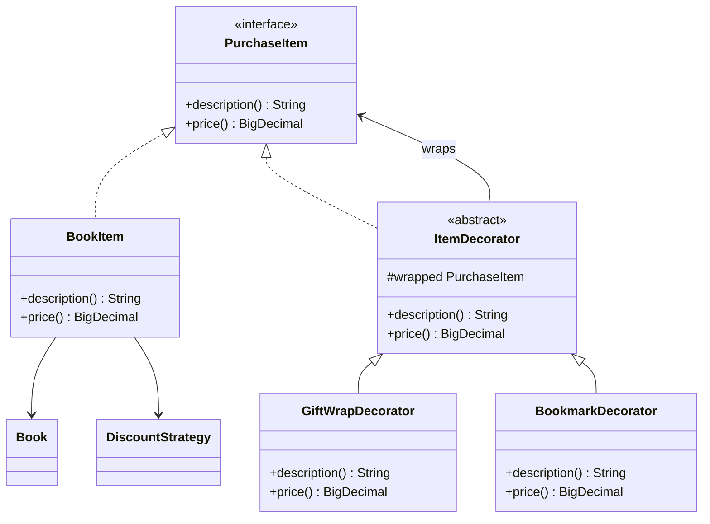
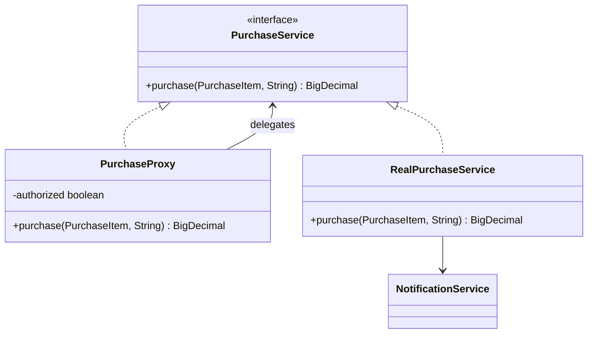
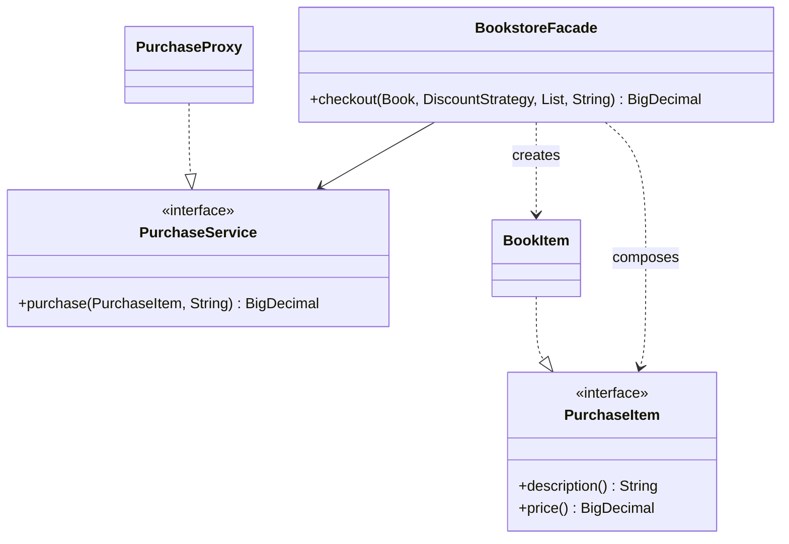
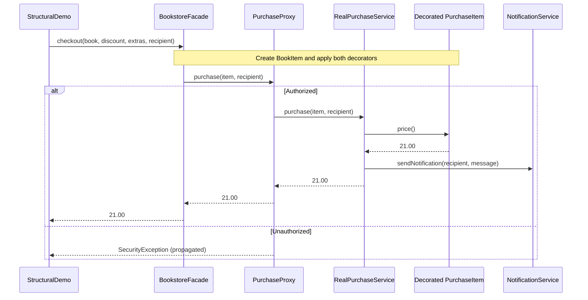

# Structural Design Patterns

### Course: Techniques and Mechanisms of Software Design

### Author: Botezatu Gabriela

---

## Theory

Structural design patterns describe how classes and objects are composed to form larger structures. Their purpose is to organize relationships between components while reducing coupling and preserving flexibility. Unlike creational patterns, which focus on object construction, structural patterns focus on how existing objects cooperate.

The **Decorator Pattern** adds responsibilities to an object dynamically by wrapping it in another object that implements the same interface. In the bookstore, optional gift wrapping and bookmarks can be combined without modifying the original book or creating a subclass for every combination.

The **Proxy Pattern** provides a stand-in for another object and controls access through the same interface. In the bookstore, the purchase proxy checks whether a customer is authorized before forwarding a purchase to the real service.

The **Facade Pattern** provides a simplified interface to a subsystem. In the bookstore, the facade coordinates item creation, optional extras and purchase processing through a single checkout method.

These patterns extend the bookstore developed in Lab 0 using SOLID principles and in Lab 1 using creational design patterns. The existing domain model, discount strategies and notification abstractions are reused.

## Objectives:

* Understand the purpose and structure of Decorator, Proxy and Facade.
* Apply Decorator to combine optional purchase extras at runtime.
* Apply Proxy to control access to the purchase service.
* Apply Facade to simplify the checkout workflow.
* Integrate the structural patterns with existing creational patterns and SOLID abstractions.
* Demonstrate cooperation, extensibility and abstraction-based dependencies through a runnable example and unit tests.

## Domain description

The Java bookstore application manages books, a shared catalog, discount strategies and purchase notifications. The structural extension introduces a checkout workflow with optional gift wrapping and bookmarks and simulated customer authorization. The existing `BookBuilder` creates the book, and `EmailNotificationFactory` creates the notification service used by the checkout subsystem.

## Implementation description

### Decorator Pattern

Gift wrapping and bookmarks are optional, independently stackable services. Modifying Book or creating a subclass for every combination would make extension difficult. PurchaseItem is the Component, BookItem the ConcreteComponent, ItemDecorator the base Decorator, and GiftWrapDecorator and BookmarkDecorator the ConcreteDecorators.

**Class diagram**



**Code snippet**

[BookItem.java](structural/decorator/BookItem.java)

```java
package structural.decorator;
import solid.srp.Book;
import solid.ocp.DiscountStrategy;
import java.math.BigDecimal;
public class BookItem implements PurchaseItem {
    private final Book book;
    private final DiscountStrategy discount;
    public BookItem(Book book, DiscountStrategy discount) {
        this.book = book;
        this.discount = discount;
    }
    public String description() { return book.getTitle(); }
    public BigDecimal price() { return discount.applyDiscount(book.getPrice()); }
}
```

[structural/decorator/ItemDecorator.java](structural/decorator/ItemDecorator.java)

```java
package structural.decorator;
import java.math.BigDecimal;
public abstract class ItemDecorator implements PurchaseItem {
    protected final PurchaseItem wrapped;
    protected ItemDecorator(PurchaseItem wrapped) { this.wrapped = wrapped; }
    public String description() { return wrapped.description(); }
    public BigDecimal price() { return wrapped.price(); }
}
```

[structural/decorator/GiftWrapDecorator.java](structural/decorator/GiftWrapDecorator.java)

```java
package structural.decorator;
import java.math.BigDecimal;
public class GiftWrapDecorator extends ItemDecorator {
    public GiftWrapDecorator(PurchaseItem wrapped) { super(wrapped); }
    public String description() { return super.description() + " + gift wrap"; }
    public BigDecimal price() { return super.price().add(new BigDecimal("2.00")); }
}
```

The decorator forwards operations to its wrapped component and adds its own behavior. New extras require only a new decorator class and selection at the composition site.

**Unit tests** ([StructuralTests.java](tests/StructuralTests.java))

* `decoratorsStackInEitherOrder` verifies both orders cost 23.00.
* `decoratorsPreserveBaseAndAddDescription` verifies the base remains unchanged and both descriptions appear.

```text
PASS decoratorsStackInEitherOrder
PASS decoratorsPreserveBaseAndAddDescription
```

### Proxy Pattern

The purchase operation must be available only to authorized customers. The Subject is PurchaseService, the RealSubject is RealPurchaseService, and the Proxy is PurchaseProxy. The authorization flag is a simulation, not a production authentication mechanism.

**Class diagram**



**Code snippet**

[structural/proxy/PurchaseProxy.java](structural/proxy/PurchaseProxy.java)

```java
package structural.proxy;
import structural.decorator.PurchaseItem;
import java.math.BigDecimal;
public class PurchaseProxy implements PurchaseService {
    private final PurchaseService realService;
    private final boolean authorized;
    public PurchaseProxy(PurchaseService realService, boolean authorized) {
        this.realService = realService;
        this.authorized = authorized;
    }
    public BigDecimal purchase(PurchaseItem item, String recipient) {
        if (!authorized) {
            throw new SecurityException("Purchase denied: unauthorized customer.");
        }
        return realService.purchase(item, recipient);
    }
}
```

The proxy checks access before calling the underlying service through the same interface. Unauthorized calls cannot trigger the purchase notification.

**Unit tests** ([StructuralTests.java](tests/StructuralTests.java))

* `proxyBlocksUnauthorizedWithoutSideEffects` checks rejection without notification.
* `proxyDelegatesAuthorized` checks the returned amount, recipient and notification description.

```text
PASS proxyBlocksUnauthorizedWithoutSideEffects
PASS proxyDelegatesAuthorized
```

### Facade Pattern

Checkout requires constructing a purchase item, applying optional decorators and calling the purchase service. BookstoreFacade coordinates these operations without implementing pricing or authorization rules itself.

**Class diagram**



**Code snippet**

[structural/facade/BookstoreFacade.java](structural/facade/BookstoreFacade.java)

```java
package structural.facade;
import structural.decorator.PurchaseItem;
import structural.decorator.BookItem;
import structural.proxy.PurchaseService;
import solid.srp.Book;
import solid.ocp.DiscountStrategy;
import java.math.BigDecimal;
import java.util.List;
import java.util.function.UnaryOperator;
public class BookstoreFacade {
    private final PurchaseService service;
    public BookstoreFacade(PurchaseService service) { this.service = service; }
    public BigDecimal checkout(Book book, DiscountStrategy discount,
            List<UnaryOperator<PurchaseItem>> extras, String recipient) {
        PurchaseItem item = new BookItem(book, discount);
        for (UnaryOperator<PurchaseItem> extra : extras) {
            item = extra.apply(item);
        }
        return service.purchase(item, recipient);
    }
}
```

The facade accepts extensible decorator functions and delegates checkout to PurchaseService; it does not need to know the concrete decorators or proxy.

**Unit tests** ([StructuralTests.java](tests/StructuralTests.java))

* `facadeAppliesExtrasBeforePurchase` uses a stub to verify ordering and amount.
* `facadeProxyIntegrationWithoutExtras` checks checkout with no extras through the proxy and real service.

```text
PASS facadeAppliesExtrasBeforePurchase
PASS facadeProxyIntegrationWithoutExtras
```

### Main class and pattern interaction

The `Main` class preserves the console menu for Labs 0 and 1 and adds option 2 for the structural demonstration. `StructuralDemo.run()` builds a book using Builder, obtains a notification service through Factory Method, and combines the three structural patterns in the same checkout workflow.

[StructuralDemo.java](structural/demo/StructuralDemo.java)

```java
        Book book = new BookBuilder().title("Throne of Glass").author("Sarah J. Maas")
            .category("Fantasy").price(new BigDecimal("20.00")).build();
        NotificationFactory factory = new EmailNotificationFactory();
        PurchaseService real = new RealPurchaseService(factory.createNotificationService());
        List<UnaryOperator<PurchaseItem>> extras = List.of(GiftWrapDecorator::new, BookmarkDecorator::new);
        System.out.println("=== Lab 2: Structural Design Patterns ===");
        System.out.println("Book: 20.00 | Student discount: 10% | Gift wrap: 2.00 | Bookmark: 1.00");
        BookstoreFacade facade = new BookstoreFacade(new PurchaseProxy(real, true));
        System.out.println("Final total: " + facade.checkout(book, new StudentDiscount(), extras, "reader@example.com"));
        try {
            new BookstoreFacade(new PurchaseProxy(real, false))
                .checkout(book, new StudentDiscount(), extras, "guest@example.com");
        } catch (SecurityException e) { System.out.println(e.getMessage()); }
```

The facade creates a `BookItem`, wraps it with both decorators and calls the `PurchaseService` abstraction. The proxy checks authorization and forwards authorized requests to `RealPurchaseService`, which evaluates the decorated price and sends a notification.



### SOLID principles and extensibility

* **SRP:** pricing, optional extras, authorization, notification and checkout coordination are separated into focused classes.
* **OCP:** a new extra can be implemented by extending `ItemDecorator` and supplied at the composition site through `UnaryOperator<PurchaseItem>`. Existing decorator, facade and service classes need no changes. Selecting the new option in the demo is a composition change, not a change to the pattern implementation.
* **DIP:** `BookItem` depends on `DiscountStrategy`, `PurchaseProxy` and `BookstoreFacade` depend on `PurchaseService`, and `RealPurchaseService` depends on `NotificationService`.

## Results

The Decorator demonstration combines gift wrapping and a bookmark with a discounted book. The original price is 20.00, and the student discount reduces it to 18.00. The extras add 2.00 and 1.00 respectively, producing a total of 21.00. The base book does not need to be modified.

The Proxy demonstration shows that the authorized request is processed and produces an email confirmation, while the unauthorized request is rejected. The Facade demonstration shows that the client can execute the complete checkout through one method instead of manually coordinating each subsystem operation.

**Console output** ([demo-output.txt](demo-output.txt))

```text
=== Lab 2: Structural Design Patterns ===
Book: 20.00 | Student discount: 10% | Gift wrap: 2.00 | Bookmark: 1.00
Email to reader@example.com: Purchase confirmed: Throne of Glass + gift wrap + bookmark; total: 21.00
Final total: 21.00
Purchase denied: unauthorized customer.
```

**Unit test execution**

Run all six checks from the project root using one command:

```powershell
powershell -ExecutionPolicy Bypass -File test.ps1
```

On Linux or macOS:

```bash
sh test.sh
```

The tests use a standalone Java test runner with explicit assertions, a recording notification implementation and a purchase-service stub. The shell test command was rerun successfully; the output matches [test-results.txt](test-results.txt).

```text
PASS decoratorsStackInEitherOrder
PASS decoratorsPreserveBaseAndAddDescription
PASS proxyBlocksUnauthorizedWithoutSideEffects
PASS proxyDelegatesAuthorized
PASS facadeAppliesExtrasBeforePurchase
PASS facadeProxyIntegrationWithoutExtras
6 tests passed.
```

## Other structural patterns

The following patterns were studied conceptually but were not implemented in this laboratory:

| Pattern | Purpose | Possible bookstore application |
| --- | --- | --- |
| Adapter | Makes an incompatible existing interface usable through the expected interface. | Integrate an external payment API behind the bookstore's own contract. |
| Bridge | Separates an abstraction from its implementation so both can vary independently. | Support different report types and output formats independently. |
| Composite | Treats individual objects and groups uniformly through a common interface. | Represent individual books and nested book bundles. |
| Flyweight | Shares immutable intrinsic state while keeping extrinsic state separate. | Share common edition metadata among many inventory entries. |

## Conclusions

This laboratory work provided a practical demonstration of three structural design patterns: Decorator, Proxy and Facade. They were implemented in the existing Java bookstore application, preserving the SOLID and creational designs developed in the previous laboratories.

The **Decorator pattern** was chosen because optional services should be combined independently without modifying the original book model. A common `PurchaseItem` interface allows both a basic item and wrapped items to be treated uniformly. The tests confirm that both decorator orders produce the expected price and that the base component remains unchanged. The description follows the wrapping order, so the textual representation is not necessarily identical in both orders.

The **Proxy pattern** was used to separate access control from purchase processing. `PurchaseProxy` preserves the `PurchaseService` interface and delegates authorized calls to the real service. The tests confirm that unauthorized calls do not trigger notifications and authorized calls return the expected amount and notification information.

The **Facade pattern** simplifies the checkout workflow by coordinating item creation, decoration and purchase delegation. It does not implement the discount calculation or authorization policy itself. The tests demonstrate that extras are applied before the service call and that checkout also works without optional extras.

The main design challenge was keeping pricing, authorization and orchestration separate while allowing all three patterns to cooperate. The order of operations is important: the discount is applied to the book before adding extras, and the proxy must check authorization before the real purchase service sends a notification. A production implementation would replace the simulated boolean authorization flag with an identity-based authorization policy and introduce actual payment and persistence services. The facade could also receive an item-creation abstraction if multiple base item types were needed.

Overall, the demonstration and six passing tests show that the patterns address actual responsibilities in the bookstore rather than isolated examples. The combined design improves flexibility, maintainability and separation of responsibilities while reusing the previous Builder, Factory Method and SOLID abstractions.

## References

1. Erich Gamma, Richard Helm, Ralph Johnson, John Vlissides. *Design Patterns: Elements of Reusable Object-Oriented Software*. Addison-Wesley, 1994.
2. Robert C. Martin. *Agile Software Development, Principles, Patterns, and Practices*. Prentice Hall, 2002.
3. Robert C. Martin. *Clean Architecture: A Craftsman's Guide to Software Structure and Design*. Prentice Hall, 2017.
4. *Laboratory Work No. 2 — Structural Design Patterns*. TMPS laboratory assignment.
